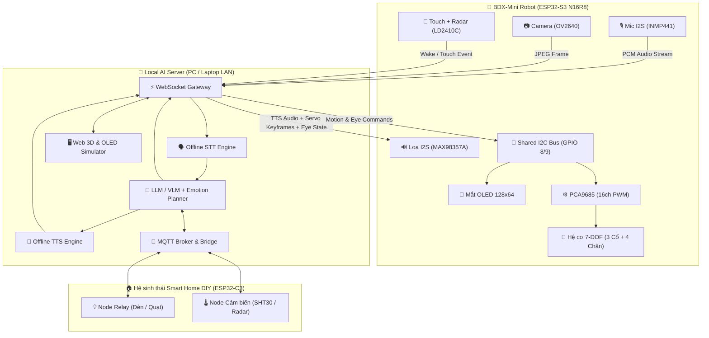

# 🤖 Buddy (BDX-Mini): Personal AI Desktop Robot & Smart Home Hub

> **Tên gọi: `Buddy` (Wake-word: *"Buddy ơi"*)** — Lấy cảm hứng thiết kế cơ khí từ Disney BDX Droid & Star Wars BD-1. Một chú Robot AI 2 chân để bàn có ngôn ngữ cơ thể sống động (7-DOF), thị giác máy tính, giao tiếp giọng nói thời gian thực (Offline-First) và đóng vai trò Trung tâm Điều khiển Nhà thông minh DIY.

---

## 🌟 Tổng quan Kiến trúc Hệ thống (System Architecture)

Dự án được thiết kế theo mô hình **Hybrid Edge-Server (Offline-First)**:
- **Edge Node (`ESP32-S3 N16R8` trên Robot):** Xử lý thời gian thực các tác vụ độ trễ thấp (thu/phát luồng âm thanh I2S, đọc cảm biến mmWave/Touch, chụp khung hình Camera OV2640, vẽ mắt hoạt họa Procedural OLED 60FPS và nội suy quỹ đạo mượt 7 trục Servo qua PCA9685).
- **Local AI Brain (Chạy trên PC/Laptop trong mạng LAN):** Đảm nhận toàn bộ pipeline AI nặng thông qua WebSocket độ trễ thấp:
  - **STT:** Whisper / Faster-Whisper / Sherpa-ONNX (nhận diện giọng nói tiếng Việt & tiếng Anh).
  - **LLM & VLM Agent:** Ollama (Qwen2.5 / Llama-3 / LLaVA / Qwen2-VL) kết hợp **Tool Calling / MCP** để điều khiển thiết bị nhà thông minh và sinh chuỗi biểu cảm cơ thể (Emotion & Gesture Choreography).
  - **TTS:** Piper / Kokoro / VieNeu-TTS tạo giọng nói tự nhiên kèm thông tin biên độ âm thanh (lip-sync / head-bobbing).
- **Smart Home DIY Nodes (`ESP32-C3`):** Các mạch vệ tinh điều khiển Relay (đèn, quạt, ổ cắm) và đọc cảm biến môi trường (`SHT30`, `LD2410`) giao tiếp qua **MQTT Broker** nội bộ hoặc **ESP-NOW**.



---

## 🦾 Cấu hình Cơ khí 7 Bậc Tự Do (7-DOF Kinematics)

| Cụm cơ khí | Khớp (Joint) | Kênh PCA9685 | Loại Servo | Chức năng biểu cảm & vận động |
| :--- | :--- | :---: | :---: | :--- |
| **Cụm Cổ (3-DOF)** | `Neck Yaw` (Quay ngang) | `CH0` | SG90 / MG90S | Xoay đầu nhìn theo người, lắc đầu từ chối (`-60°` đến `+60°`) |
| | `Neck Pitch` (Gật/Ngửa) | `CH1` | MG90S | Gật đầu đồng ý, cúi đầu buồn, ngước nhìn lên (`-35°` đến `+45°`) |
| | `Neck Roll` (Nghiêng đầu) | `CH2` | SG90 / MG90S | Nghiêng đầu tò mò kiểu chó con / BD-1 khi lắng nghe (`-30°` đến `+30°`) |
| **Cụm Chân (4-DOF)** | `Left Hip` (Hông trái) | `CH4` | MG90S (Metal) | Bước đi, xoay người, tạo dáng Reverse-Knee |
| | `Right Hip` (Hông phải) | `CH5` | MG90S (Metal) | Bước đi, xoay người, tạo dáng Reverse-Knee |
| | `Left Foot/Ankle` (Cổ chân trái) | `CH6` | MG90S (Metal) | Nghiêng trọng tâm giữ thăng bằng tĩnh/động, nhún nhảy |
| | `Right Foot/Ankle` (Cổ chân phải)| `CH7` | MG90S (Metal) | Nghiêng trọng tâm giữ thăng bằng tĩnh/động, ngồi khóa chân |

---

## 📂 Cấu trúc Thư mục Dự án (Monorepo Structure)

```text
bdx-robot/
├── README.md                          # Tài liệu tổng quan dự án
├── docs/                              # Tài liệu Kiến trúc, Sơ đồ chân & Giao thức
│   ├── PINOUT_AND_BOM.md              # Sơ đồ nối dây chi tiết & Danh sách linh kiện (BOM)
│   └── ARCHITECTURE_AND_PROTOCOL.md   # Đặc tả giao thức WebSocket/MQTT & State Machine
├── firmware-robot-s3/                 # Firmware chính cho ESP32-S3 N16R8 trên Robot
│   ├── include/                       # Header cấu hình hệ thống & Pinout
│   ├── src/                           # Luồng thực thi chính (FreeRTOS Tasks)
│   └── lib/
│       ├── display_oled/              # Engine vẽ mắt hoạt họa Procedural (128x64 I2C)
│       ├── kinematics_7dof/           # Bộ nội suy chuyển động Easing & Oscillator 7 servo
│       ├── audio_i2s/                 # Driver thu/phát âm thanh I2S (INMP441 + MAX98357A)
│       ├── camera_vision/             # Driver Camera OV2640 (PSRAM Framebuffer)
│       └── network_protocol/          # Client WebSocket & MQTT đồng bộ trạng thái
├── firmware-smarthome-nodes/          # Firmware cho các node vệ tinh nhà thông minh (ESP32-C3)
│   ├── common_mesh_mqtt/              # Thư viện giao tiếp MQTT / ESP-NOW dùng chung
│   ├── node_relay_c3/                 # Node điều khiển công tắc Relay (Đèn, Quạt)
│   └── node_env_sensor_c3/            # Node đọc nhiệt ẩm SHT30 & hiện diện
├── local-ai-server/                   # Máy chủ AI chạy trên PC/Laptop (Python)
│   ├── stt/                           # Module Speech-to-Text (Faster-Whisper / Sherpa)
│   ├── llm_agent/                     # Bộ não LLM/VLM, quản lý cảm xúc & MCP Tool Calling
│   ├── tts/                           # Module Text-to-Speech Offline
│   ├── mqtt_bridge/                   # Cầu nối điều khiển Smart Home qua MQTT
│   └── web_simulator/                 # Giao diện Web mô phỏng mắt OLED & khớp 7-DOF trên PC
└── hardware-cad-bom/                  # Thiết kế cơ khí 3D & Sơ đồ mạch điện
    ├── MECHANICAL_DESIGN_NOTES.md     # Hướng dẫn thiết kế CAD in 3D kiểu dáng BDX-Mini
    ├── schematics/                    # Sơ đồ nguyên lý nguồn UBEC & PCB/Perfboard
    └── stl_models/                    # Thư mục chứa file in 3D (.STL / .STEP)
```

---

## 🗺️ Lộ trình Phát triển (Development Roadmap)

1. **Giai đoạn 1 — Mô phỏng & Bộ não AI trên PC (Không cần phần cứng):**
   - Xây dựng `local-ai-server/web_simulator` để giả lập màn hình OLED 128x64 (mắt chớp, biểu cảm) và mô hình 3D 7 bậc tự do của cổ + chân ngay trên trình duyệt.
   - Kết nối pipeline `STT -> LLM (Ollama) -> TTS` và kiểm thử kịch bản: nói chuyện với Robot ảo trên màn hình, xem mắt và cổ phản ứng theo cảm xúc.
2. **Giai đoạn 2 — Prototype Phần cứng trên Breadboard:**
   - Nạp firmware cho `ESP32-S3 N16R8`, kiểm tra bus I2C dùng chung (`OLED` + `PCA9685`), luồng âm thanh 2 chiều `INMP441` / `MAX98357A` và `Camera OV2640`.
3. **Giai đoạn 3 — In 3D, Lắp ráp Cơ khí 7-DOF & Hiệu chỉnh (Calibration):**
   - In 3D khung vỏ BDX-Mini, cân chỉnh điểm Zero (`90°`) cho 7 Servo, tinh chỉnh thuật toán đi bộ và ngôn ngữ cơ thể.
4. **Giai đoạn 4 — Tích hợp Hệ sinh thái Smart Home DIY:**
   - Triển khai các node `ESP32-C3` điều khiển thiết bị thật trong phòng qua giọng nói với BDX-Mini.

---

## 📖 Tài liệu Tham khảo Nhanh
- 📌 [Sơ đồ Chân (Pinout), Sơ đồ Nguồn & Danh mục Linh kiện (BOM)](./docs/PINOUT_AND_BOM.md)
- 📡 [Kiến trúc Phần mềm & Giao thức Truyền thông (WebSocket / MQTT)](./docs/ARCHITECTURE_AND_PROTOCOL.md)
- 🛠️ [Ghi chú Thiết kế Cơ khí & In 3D BDX-Mini](./hardware-cad-bom/MECHANICAL_DESIGN_NOTES.md)
