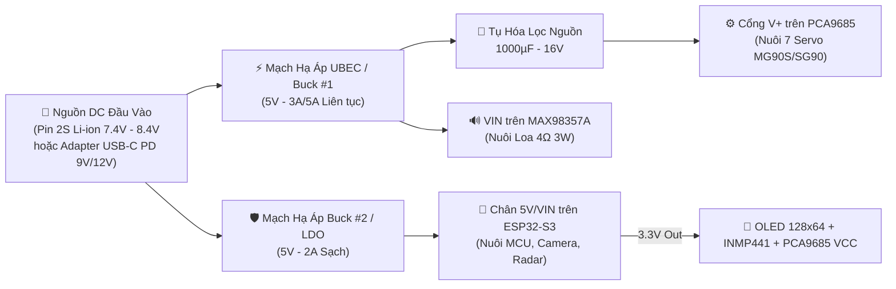

# 🔌 Sơ Đồ Chân (Pinout), Kiến Trúc Nguồn & Danh Mục Linh Kiện (BOM)

Tài liệu này quy định chuẩn kết nối phần cứng cho toàn bộ hệ thống **BDX-Mini Droid (ESP32-S3 N16R8)** và các **Node Smart Home vệ tinh (ESP32-C3)**.

> [!CAUTION]
> **Lưu ý sống còn với chip `ESP32-S3 N16R8` (8MB Octal PSRAM):**
> Các chân **GPIO 35, GPIO 36, GPIO 37** đã được sử dụng nội bộ cho giao tiếp **Octal SPI PSRAM & Flash**. Tuyệt đối **KHÔNG** kết nối bất kỳ ngoại vi nào vào 3 chân này để tránh lỗi treo chip (`Cache disabled but cached memory region accessed`).

---

## 1. Sơ Đồ Chân Tổng Thể Trên Robot (`ESP32-S3 N16R8`)

Thiết kế dưới đây tương thích hoàn toàn với board **`ESP32-S3-WROOM N16R8 CAM`** (loại có sẵn khe cắm cáp FPC 24-pin cho Camera OV2640 và 2 hàng chân rào ra ngoài), giúp đi dây gọn nhất và tránh mọi xung đột phần cứng.

### 1.1. Bus I2C Dùng Chung: Màn hình Mắt OLED + Mạch Servo PCA9685
Sử dụng duy nhất 2 chân GPIO cho bus `I2C_NUM_0` (tần số `400kHz Fast Mode`), phân biệt thiết bị qua địa chỉ I2C:
- **Màn hình OLED 0.96" / 1.3" (SSD1306 / SH1106):** Địa chỉ I2C = `0x3C`
- **Mạch điều khiển 16 kênh Servo PCA9685:** Địa chỉ I2C = `0x40` (mặc định khi không hàn jumper A0-A5)

| Chân Thiết Bị (OLED & PCA9685) | Chân `ESP32-S3` | Ghi chú Kỹ thuật |
| :--- | :---: | :--- |
| **SDA** (Dữ liệu I2C) | `GPIO 1` | Dùng chung cho cả OLED và PCA9685 (có sẵn trở kéo lên trên module) |
| **SCL** (Xung nhịp I2C) | `GPIO 2` | Dùng chung cho cả OLED và PCA9685 (chạy ở tốc độ `400kHz`) |
| **VCC (Logic)** | `3.3V` | Cấp nguồn logic 3.3V cho OLED và chip điều khiển PCA9685 |
| **GND** | `GND` | **Bắt buộc nối GND chung** giữa ESP32-S3, PCA9685 và nguồn UBEC 5V |
| **V+ (Trên PCA9685)** | `5V UBEC (3A)` | **Nguồn động lực riêng cho 7 Servo**, KHÔNG lấy từ chân 5V của ESP32 |
| **OE (Output Enable - PCA9685)**| `Bỏ trống / GND`| Mặc định kéo xuống GND trên mạch để luôn bật PWM |

---

### 1.2. Bảng Phân Bổ 7 Kênh Servo Trên Mạch `PCA9685`

Để đi dây gọn từ phần Đầu xuống Thân và từ Thân xuống Chân, các kênh trên PCA9685 được quy hoạch theo 2 cụm tách biệt:

| Kênh PCA9685 | Tên Khớp (Joint ID) | Vị trí Cơ khí | Loại Servo Khuyến nghị | Góc Trung tâm (Home) | Giới hạn An toàn (Min - Max) |
| :---: | :--- | :--- | :--- | :---: | :---: |
| **`CH0`** | `NECK_YAW` | Cổ - Quay trái/phải | MG90S / SG90 | `90°` | `30°` – `150°` |
| **`CH1`** | `NECK_PITCH` | Cổ - Gật lên/xuống | MG90S (Bánh răng đồng) | `90°` | `55°` – `135°` |
| **`CH2`** | `NECK_ROLL` | Cổ - Nghiêng đầu | SG90 / MG90S | `90°` | `60°` – `120°` |
| **`CH3`** | *(Dự phòng)* | Tai / Ăng-ten BD-1 | SG90 Sub-micro | `90°` | `0°` – `180°` |
| **`CH4`** | `LEFT_HIP` | Chân Trái - Khớp Hông | MG90S (Kim loại 100%) | `90°` | `35°` – `145°` |
| **`CH5`** | `RIGHT_HIP` | Chân Phải - Khớp Hông | MG90S (Kim loại 100%) | `90°` | `35°` – `145°` |
| **`CH6`** | `LEFT_ANKLE` | Chân Trái - Bàn Chân | MG90S (Kim loại 100%) | `90°` | `40°` – `140°` |
| **`CH7`** | `RIGHT_ANKLE` | Chân Phải - Bàn Chân | MG90S (Kim loại 100%) | `90°` | `40°` – `140°` |

---

### 1.3. Hệ Thống Âm Thanh 2 Chiều I2S (`INMP441` + `MAX98357A`)

> [!TIP]
> **Tối ưu GPIO với Full-Duplex I2S:** Trên ESP32-S3, cả Micro `INMP441` và Amply `MAX98357A` có thể dùng chung cặp xung nhịp `BCLK` và `WS/LRCLK` trên cùng bộ điều khiển `I2S_NUM_0` (cùng tần số lấy mẫu `16kHz, 16-bit, Mono`), giúp tiết kiệm 2 chân GPIO và đồng bộ xung nhịp hoàn hảo cho tính năng khử vọng âm (AEC).

| Thiết bị | Chân Module | Chân `ESP32-S3` | Ghi chú Kết nối |
| :--- | :--- | :---: | :--- |
| **Micro số `INMP441`** *(Đặt trên Đầu)* | `SCK` (Serial Clock) | `GPIO 38` | Dùng chung đường xung nhịp `I2S_BCLK` |
| | `WS` (Word Select) | `GPIO 39` | Dùng chung đường chọn kênh `I2S_WS / LRC` |
| | `SD` (Serial Data Out) | `GPIO 40` | Đường dữ liệu thu âm vào ESP32 (`I2S_DIN`) |
| | `L/R` (Kênh Trái/Phải)| `GND` | Nối xuống `GND` để chọn kênh **Left (Mono)** |
| | `VDD` & `GND` | `3.3V` & `GND` | **Chỉ cấp 3.3V** cho INMP441 (cấp 5V sẽ cháy mic!) |
| **Amply `MAX98357A`** *(Đặt trong Thân)*| `BCLK` (Bit Clock) | `GPIO 38` | Nối chung với `SCK` của INMP441 |
| | `LRC` (Left/Right Clk)| `GPIO 39` | Nối chung với `WS` của INMP441 |
| | `DIN` (Data In) | `GPIO 41` | Đường dữ liệu phát âm thanh từ ESP32 (`I2S_DOUT`) |
| | `SD` (Shutdown/Mode) | `Bỏ trống` | Để trống tự động trộn kênh Mono |
| | `GAIN` | `GND` / `Bỏ trống`| Nối GND = `12dB`, để trống = `9dB` |
| | `VIN` & `GND` | `5V UBEC` & `GND` | Cấp 5V từ UBEC để tiếng loa 4Ω-3W to, rõ và không sụt áp MCU |

---

### 1.4. Cảm Biến Tương Tác (`Touch` + Radar `HLK-LD2410C`)

| Thiết bị | Chân Module | Chân `ESP32-S3` | Chức năng |
| :--- | :--- | :---: | :--- |
| **Cảm biến Chạm đỉnh đầu** | `Touch Pad` / `TTP223 I/O` | `GPIO 14` | Hỗ trợ cảm ứng điện dung nội sinh (`TOUCH14`) hoặc module TTP223 |
| **Radar mmWave `HLK-LD2410C`**| `OUT` (Digital Presence) | `GPIO 42` | Mức `HIGH (3.3V)` khi phát hiện có người lại gần bàn làm việc |
| | `UART_TX` (Từ Radar) | `GPIO 47` *(Tùy chọn)*| Đọc khoảng cách chi tiết (cm) & năng lượng chuyển động/tĩnh |
| | `UART_RX` (Vào Radar) | `GPIO 48` *(Tùy chọn)*| Cấu hình độ nhạy vùng phát hiện qua `UART1` |
| | `VCC` & `GND` | `5V` & `GND` | `HLK-LD2410C` yêu cầu nguồn đầu vào **5V** (logic IO vẫn là 3.3V an toàn) |

---

### 1.5. Camera Thị Giác Máy Tính (`OV2640` - Khe FPC 24-pin trên Board)

Nếu sử dụng board **`ESP32-S3-WROOM N16R8 CAM`**, các chân dưới đây đã được nối sẵn trên mạch in tới khe cắm cáp FPC 24-pin (bạn chỉ cần cắm cáp nối dài OV2640 lên đầu Robot mà không cần hàn dây):

| Tín hiệu Camera | GPIO Nội bộ (`ESP32-S3-CAM`) | Tín hiệu Camera | GPIO Nội bộ (`ESP32-S3-CAM`) |
| :--- | :---: | :--- | :---: |
| `XCLK` | `GPIO 15` | `Y9 (D7)` | `GPIO 16` |
| `PCLK` | `GPIO 13` | `Y8 (D6)` | `GPIO 17` |
| `VSYNC` | `GPIO 6` | `Y7 (D5)` | `GPIO 18` |
| `HREF` | `GPIO 7` | `Y6 (D4)` | `GPIO 12` |
| `SIOD (CAM_SDA)` | `GPIO 4` | `Y5 (D3)` | `GPIO 10` |
| `SIOC (CAM_SCL)` | `GPIO 5` | `Y4 (D2)` | `GPIO 8` |
| `PWDN / RESET` | `-1` (Không dùng) | `Y3 (D1)` / `Y2 (D0)` | `GPIO 9` / `GPIO 11` |

---

## 2. Kiến Trúc Cấp Nguồn Chống Sụt Áp (Power Distribution)

7 động cơ Servo (`MG90S`/`SG90`) khi đồng loạt khởi động hoặc đổi hướng có thể rút dòng đỉnh (Stall/Peak Current) lên tới **2.5A – 3.5A**. Do đó, thiết kế nguồn bắt buộc phải tách nhánh Động lực và nhánh Logic:

- **Tụ bù sụt áp:** Hàn thêm 1 tụ hóa **`1000µF / 16V`** ngay tại domino cấp nguồn `V+` và `GND` trên mạch `PCA9685`.
- **Dây dẫn lên Đầu Robot:** Từ thân lên đầu chỉ cần đi **1 bó dây mềm Silicon AWG28 (8 sợi)** luồn qua cổ + **1 cáp dẹt FPC nối dài cho Camera OV2640**:
  - `3.3V`, `GND`, `SDA (GPIO 1)`, `SCL (GPIO 2)` -> Cho màn hình OLED 128x64.
  - `I2S_BCLK (GPIO 38)`, `I2S_WS (GPIO 39)`, `I2S_DIN (GPIO 40)` -> Cho Micro `INMP441` (dùng chung `3.3V` và `GND` với OLED!).
  - `TOUCH (GPIO 14)` -> Cho miếng đồng cảm ứng chạm trên đỉnh đầu.

---

## 3. Danh Mục Linh Kiện Đầy Đủ (Bill of Materials - BOM)

### 3.1. Phần Cứng Robot Trung Tâm (`BDX-Mini Droid`)

| STT | Nhóm | Tên Linh Kiện | Thông số / Mã chuẩn | Số lượng | Ghi chú Chọn mua |
| :-: | :--- | :--- | :--- | :---: | :--- |
| 1 | **Vi điều khiển & Camera** | Board `ESP32-S3 N16R8 CAM` | 16MB Flash, 8MB Octal PSRAM, kèm `OV2640` | 01 bộ | Chọn bản có cáp `OV2640` dây dài `15cm - 20cm` (hoặc mua thêm cáp nối dài FPC 24-pin) |
| 2 | **Thị giác / Biểu cảm** | Màn hình OLED I2C | `0.96"` (SSD1306) hoặc `1.3"` (SH1106), 128x64, Trắng/Xanh | 01 cái | Loại 4 chân (`GND, VCC, SCL, SDA`), nhẹ chỉ ~5g |
| 3 | **Hệ Cơ 7-DOF** | Động cơ Servo `MG90S` | Bánh răng kim loại (Metal Gear), góc quay 180° | 05 - 07 cái | Dùng tối thiểu 5 cái MG90S cho 4 khớp Chân + 1 khớp Cổ Pitch |
| 4 | | Động cơ Servo `SG90` | Bánh răng nhựa (9g), góc quay 180° | 00 - 02 cái | Có thể dùng cho 2 khớp Cổ `Yaw` & `Roll` để giảm tải trọng đầu |
| 5 | **Điều khiển Servo** | Mạch PWM `PCA9685` | 16 kênh PWM 12-bit, giao tiếp I2C (`0x40`) | 01 mạch | Có sẵn hàng rào cắm cho 7 Servo |
| 6 | **Âm thanh 2 chiều** | Micro số `INMP441` | I2S Omnidirectional MEMS Microphone | 01 mạch | Nhớ kiểm tra chân hàn chuẩn, cấp nguồn 3.3V |
| 7 | | Mạch khuếch đại `MAX98357A`| I2S Class-D Amplifier 3W | 01 mạch | Giao tiếp số I2S chống nhiễu tuyệt đối |
| 8 | | Loa toàn dải Mini | `4Ω - 3W` (kích thước 28mm - 40mm, có hộp cộng hưởng càng tốt) | 01 cái | Đặt trong khoang bụng của BDX-Mini |
| 9 | **Cảm biến Tương tác**| Radar mmWave `HLK-LD2410C` | Cảm biến hiện diện 24GHz (Bluetooth + UART + IO) | 01 cái | Phát hiện cả người ngồi yên làm việc trước bàn |
| 10 | | Cảm biến chạm `TTP223` | Hoặc băng dính đồng (Copper Tape) nối trực tiếp vào `GPIO 14` | 01 cái | Dán mặt trong vỏ nhựa đỉnh đầu Robot |
| 11 | **Hệ thống Nguồn** | Mạch hạ áp `UBEC 5V-3A` | Hoặc module Buck `MP1584EN` / `XL4015` chỉnh chuẩn 5.0V | 01 - 02 cái | Cấp nguồn riêng cho PCA9685 + Loa |
| 12 | | Nguồn nuôi chính | Pin `2S 18650 (7.4V)` kèm mạch BMS + Sạc, hoặc mạch `USB-C PD Trigger 9V/12V` | 01 bộ | Để bàn lâu dài khuyến nghị dùng `USB-C PD Trigger` kết hợp Pin đệm |
| 13 | **Phụ kiện Cơ khí** | Vòng bi mini (Bearings) | Loại `MR85ZZ` (5x8x2.5mm) hoặc `6700ZZ` (tùy bản vẽ CAD khớp cổ/hông) | 04 - 06 cái | Giúp khớp cổ và khớp hông chịu lực đồng trục mượt mà |
| 14 | | Ốc vít & Dây dẫn | Bộ ốc `M2`, `M2.5`, `M3` + Dây Silicon mềm `AWG28` + Tụ `1000µF 16V` | 01 bộ | Dây Silicon mềm giúp cổ Robot xoay không bị cứng dây |

---

### 3.2. Phần Cứng Các Node Smart Home Vệ Tinh (Tùy chọn mở rộng)

| STT | Tên Linh Kiện | Thông số / Mã chuẩn | Số lượng | Ứng dụng trong hệ thống |
| :-: | :--- | :--- | :---: | :--- |
| 1 | Board `ESP32-C3 SuperMini` | Wi-Fi + BLE 5.0, siêu nhỏ gọn | 02 - 04 cái | Làm vi điều khiển cho từng node công tắc / cảm biến phòng |
| 2 | Module Relay 1-2 Kênh | `5V Opto-isolated Relay` (kích mức Low/High) | 02 cái | Điều khiển bật/tắt đèn bàn, quạt, thiết bị điện |
| 3 | Cảm biến Nhiệt Ẩm `SHT30` | Giao tiếp I2C, độ chính xác cao | 01 - 02 cái | Báo cáo nhiệt độ/độ ẩm phòng cho Robot nhắc nhở sức khỏe |
| 4 | Nguồn `HLK-PM01` (AC-DC 5V) | Hoặc củ sạc USB 5V nhỏ gọn | 02 - 04 cái | Cấp nguồn cho các node ESP32-C3 âm tường / để góc phòng |
